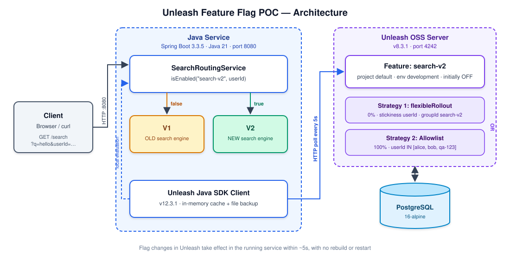

# Unleash Feature Flag POC (Java 21, Spring Boot, Maven)

A minimal, runnable Proof-of-Concept demonstrating runtime feature toggling with Unleash OSS, Spring Boot, Java 21, and Unleash's native Java SDK.

The goal is to demonstrate deploying a Java service **once**, and altering its routing behavior dynamically via Unleash without rebuilding or restarting the Java service.

---

## 1. Architecture & Local Setup



### Component Versions (Pinned)
- **Unleash Server**: `unleashorg/unleash-server:8.3.1`
- **Database**: `postgres:16-alpine`
- **Java SDK**: `io.getunleash:unleash-client-java:12.3.1`
- **Spring Boot**: `3.3.5`
- **Java**: `21`

### Local Demo Credentials (Strictly Local-Only)
> **WARNING**: The credentials below are provided strictly for local sandbox demonstration. Do not use these in production or shared environments!

- **Unleash Admin API Token** (Automation / Bootstrap):
  `*:*.local-demo-admin-token-not-for-production`
- **Java Backend Client Token** (SDK Read-Only):
  `default:development.local-demo-backend-token-for-java-service`
- **Unleash Web UI Login** (Optional UI access at `http://localhost:4242`):
  Username: `admin` | Password: `unleashpassword` (or default prompt on first login)

---

## 2. Prerequisites

- **macOS** with Docker Desktop / Colima running
- **Java 21** (`java -version`)
- **IntelliJ IDEA** (Community or Ultimate) or Maven Wrapper (`./mvnw`)
- **curl** and **python3** (standard on macOS)

---

## 3. Quick Start

### Step 1: Start Unleash & Database
```bash
docker compose up -d
```
Verify Unleash is healthy:
```bash
curl http://localhost:4242/health
# Returns: {"health":"GOOD"}
```

### Step 2: Bootstrap the `search-v2` Feature Flag
Run the repeatable bootstrap script (uses Unleash Admin API):
```bash
./scripts/bootstrap-unleash.sh
```
This script:
1. Creates the `search-v2` release toggle if missing.
2. Clears any default strategies to prevent accidental unrestricted 100% rollouts.
3. Configures **Strategy 1**: `flexibleRollout` (0% rollout, stickiness `userId`, groupId `search-v2`).
4. Configures **Strategy 2**: Allowlist with 100% rollout constrained to `userId IN [alice, bob, qa-123]`.
5. Sets the flag in `development` to **OFF**.

### Step 3: Run the Java Service
#### Option A: Running from IntelliJ IDEA
1. Open the project folder (`feature-ops-poc`) in IntelliJ.
2. Ensure **Project SDK** is set to **Java 21** (`File > Project Structure > Project > SDK`).
3. Run the preconfigured run configuration:
   - Select **SearchServiceApplication** in the top run dropdown.
   - Click **Run** (or `Shift + F10`).
   - The configuration is saved in `.run/SearchServiceApplication.run.xml`.

#### Option B: Running from Terminal (Maven Wrapper)
```bash
JAVA_HOME=$(/usr/libexec/java_home -v 21 2>/dev/null || echo $JAVA_HOME) ./mvnw spring-boot:run
```
The service will start on `http://localhost:8080`. You will see log messages indicating that the Unleash client connected and polled toggles.

### Step 4: Access the Demo Web UI
Open your browser at:
```
http://localhost:8080/
```
The self-contained UI provides:
- Live flag state and rollout percentage indicators.
- Quick buttons to toggle `search-v2` ON / OFF.
- Buttons to set rollout percentage (0%, 10%, 50%, 100%).
- Interactive search query tester with one-click user presets (`alice`, `bob`, `qa-123`, `charlie`, `Random User`).
- Visual indicator showing `V1 (OLD Engine)` in amber or `V2 (NEW Engine)` in emerald green.
- Built-in 100-user distribution test with a live split bar chart.

---

## 4. Feature Flag Strategy & OR Semantics

In Unleash, multiple strategies on a toggle combine using **OR logic**:
1. When the flag is **OFF**: Everyone receives `v1`. No strategies are evaluated.
2. When the flag is **ON**:
   - If user matches the **Allowlist Strategy** (`alice`, `bob`, or `qa-123`), the toggle evaluates to `true` (`v2`).
   - Otherwise, the user is evaluated against the **Percentage Rollout Strategy**. If the user's hash falls within the active rollout percentage, they receive `v2`; otherwise `v1`.
3. Because both strategies are scoped (0% rollout and explicit allowlist), no user outside the allowlist gets `v2` until the percentage is increased.

---

## 5. Equivalent UI Steps (Unleash Admin Dashboard)

If you prefer using the Unleash Web UI at `http://localhost:4242`:

1. Open `http://localhost:4242` in your browser.
2. Navigate to **Projects > Default > Feature flags**.
3. Click **New feature flag**:
   - Name: `search-v2`
   - Type: `Release`
   - Click **Create flag**.
4. Click on the `search-v2` flag and select the **development** environment tab.
5. Under **Strategies**, delete any auto-created 100% strategy.
6. Click **Add strategy**:
   - Select **Gradual rollout** (`flexibleRollout`).
   - Rollout: `0%`.
   - Stickiness: `userId`.
   - Group ID: `search-v2`.
   - Click **Save strategy**.
7. Click **Add strategy** again:
   - Select **Gradual rollout** (`flexibleRollout`).
   - Rollout: `100%`.
   - Click **Add constraint**:
     - Context field: `userId`.
     - Operator: `IN`.
     - Values: `alice`, `bob`, `qa-123`.
   - Click **Save strategy**.
8. Set the toggle switch for **development** to **OFF**.

---

## 6. Demonstration & Verification Walkthrough

Run the Java service on port 8080 and execute the following steps:

### Scenario 1: Input Validation
Missing or blank `userId` returns HTTP 400 Bad Request:
```bash
# Missing userId -> HTTP 400
curl -i "http://localhost:8080/search?q=hello"

# Blank userId -> HTTP 400
curl -i "http://localhost:8080/search?q=hello&userId=%20%20"
```

### Scenario 2: Flag OFF -> Everyone gets V1
When `search-v2` is OFF, even allowlisted users receive V1:
```bash
# Allowlisted user:
curl -s "http://localhost:8080/search?q=hello&userId=alice"
# {"query":"hello","userId":"alice","implementation":"v1","message":"Results from OLD search engine"}

# General user:
curl -s "http://localhost:8080/search?q=hello&userId=charlie"
# {"query":"hello","userId":"charlie","implementation":"v1","message":"Results from OLD search engine"}
```

### Scenario 3: Flag ON, 0% Rollout -> Only Allowlist gets V2
Turn the flag ON via helper script:
```bash
./scripts/set-flag-state.sh on
```
Wait 5 seconds for the Java SDK polling interval. Then test:
```bash
# Allowlisted IDs receive V2:
curl -s "http://localhost:8080/search?q=hello&userId=alice"
# {"query":"hello","userId":"alice","implementation":"v2","message":"Results from NEW search engine"}

curl -s "http://localhost:8080/search?q=hello&userId=bob"
# {"query":"hello","userId":"bob","implementation":"v2","message":"Results from NEW search engine"}

curl -s "http://localhost:8080/search?q=hello&userId=qa-123"
# {"query":"hello","userId":"qa-123","implementation":"v2","message":"Results from NEW search engine"}

# Non-allowlisted users still receive V1 (rollout is 0%):
curl -s "http://localhost:8080/search?q=hello&userId=charlie"
# {"query":"hello","userId":"charlie","implementation":"v1","message":"Results from OLD search engine"}
```

### Scenario 4: Rollout at 10% -> ~10% of Non-Allowlisted IDs get V2
Increase rollout to 10% dynamically without touching or restarting Java:
```bash
./scripts/set-flag-state.sh percentage 10
```
Wait 5 seconds for poll refresh. Then run the 1,000-user distribution check:
```bash
./scripts/verify-distribution.sh 1000
```
**Sample Output:**
```
Sending 1000 requests to http://localhost:8080/search...
--- Distribution Results ---
Total Requests: 1000
V1 (OLD Engine): 907 (90.7%)
V2 (NEW Engine): 93 (9.3%)
```
Allowlisted IDs (`alice`, `bob`, `qa-123`) continue to always receive V2.

### Scenario 5: Deterministic Stickiness
Flexible rollout calculates a deterministic MurmurHash3 value on `(userId + groupId)`. The same user will always receive the exact same implementation:
```bash
# Repeat 5 times for random-user-12 (consistently V1):
for i in {1..5}; do curl -s "http://localhost:8080/search?q=hello&userId=random-user-12"; echo ""; done

# Repeat 5 times for random-user-99 (consistently V2):
for i in {1..5}; do curl -s "http://localhost:8080/search?q=hello&userId=random-user-99"; echo ""; done
```

### Scenario 6: Increase to 50%, then 100% (No Restart)
```bash
# Increase to 50%
./scripts/set-flag-state.sh percentage 50
sleep 6
./scripts/verify-distribution.sh 1000
# Expected: ~50% V2 (~500-550 V2 responses)

# Increase to 100%
./scripts/set-flag-state.sh percentage 100
sleep 6
./scripts/verify-distribution.sh 1000
# Expected: 100% V2 (1000 V2 responses, 0 V1 responses)
```

### Scenario 7: Switch OFF -> Everyone Returns to V1
```bash
./scripts/set-flag-state.sh off
sleep 6
curl -s "http://localhost:8080/search?q=hello&userId=alice"
# {"query":"hello","userId":"alice","implementation":"v1","message":"Results from OLD search engine"}

./scripts/verify-distribution.sh 1000
# Total Requests: 1000 | V1: 1000 (100.0%) | V2: 0 (0.0%)
```

---

## 7. SDK Resiliency & Outage Behavior

- **In-Memory Cache & Local File Backup**: The Unleash Java SDK maintains all evaluated flag rules locally in memory, updated every 5 seconds. In addition, the SDK backs up rules to a local temporary JSON file.
- **Outage Survival**: If the Unleash server or network connection fails:
  - The SDK logs a communication warning and **retains the cached rules**.
  - **The flag does NOT automatically revert to OFF during an outage**. Customer requests continue to evaluate using the latest known rules.
  - If the application starts cold during an outage and no local backup file exists, it uses the fallback value provided in the code (`false`, routing safely to V1).

---

## 8. Shutdown & Cleanup

1. **Stop Java Service**: Stop the application in IntelliJ or press `Ctrl + C` in the terminal.
2. **Stop Unleash & Database**:
```bash
docker compose down
```
To also purge database volumes:
```bash
docker compose down -v
```

---

## 9. Troubleshooting

| Issue | Cause | Solution |
|---|---|---|
| `Cannot connect to the Docker daemon` | Docker Desktop is not running | Start Docker Desktop (`open -a Docker`) and wait until running. |
| `Address already in use: 8080` | Another process is occupying port 8080 | Run `lsof -i :8080` and `kill -9 <PID>` or change `server.port` in `application.yml`. |
| `Address already in use: 4242` | Another Unleash instance is running | Stop the competing process or run `docker compose down`. |
| `401 / 403 Forbidden` on Admin API | Incorrect admin token | Check `INIT_ADMIN_API_TOKENS` in `docker-compose.yml` matches `UNLEASH_ADMIN_TOKEN`. |
| SDK not picking up toggle changes | Polling interval delay | Default refresh interval is 5 seconds. Wait 5-6 seconds after updating a flag. |
| Flag evaluates to false despite being ON | Stickiness context mismatch | Verify `userId` is passed in request. The flexible rollout requires `userId` for hash calculation. |
